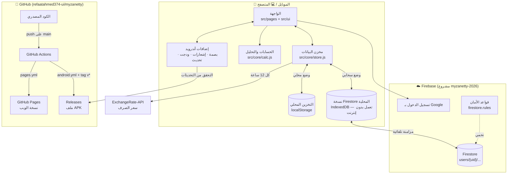
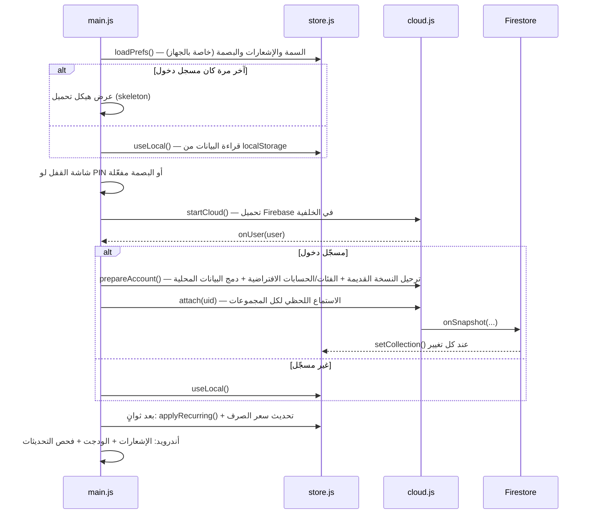

# خريطة المشروع — كيف يعمل تطبيق ميزانيتي

> هذا الملف يشرح **كل أجزاء التطبيق وكيف تتصل ببعضها**. لو عندك مشكلة وتريد حلها مباشرة، افتح [دليل الإصلاح](TROUBLESHOOTING.md). ولإصدار نسخة جديدة، افتح [خطوات الإصدار](RELEASING.md).

## 1. الصورة الكاملة



**الفكرة الأساسية:** كود واحد (HTML/CSS/JavaScript) يعمل في ثلاثة أماكن:

| المكان | كيف يصل للمستخدم |
|---|---|
| موقع ويب | `https://refaatahmed374-ui.github.io/myzanetty/` — ينشره `pages.yml` تلقائياً |
| تطبيق مثبّت من المتصفح (PWA) | نفس الموقع ← "تثبيت التطبيق" من Chrome — يعمل بدون إنترنت عبر Service Worker |
| تطبيق أندرويد (APK) | نفس الكود مغلّف بـ **Capacitor** — يبنيه `android.yml` وينشره في Releases |

## 2. هيكل الملفات

```
ميزانيتي/
├── index.html                 الصفحة الوحيدة (كل شيء يُرسم بالـ JavaScript)
├── vite.config.js             إعدادات البناء + PWA (manifest و Service Worker)
├── capacitor.config.json      إعدادات تطبيق أندرويد (المعرّف com.myzanetty.app والإضافات)
├── firestore.rules            قواعد أمان قاعدة البيانات (تُنشر يدوياً من Firebase Console)
├── firebase.json / .firebaserc  إعدادات Firebase CLI (اختياري)
├── package.json               المكتبات + الأوامر (dev, build, test…) + رقم الإصدار
│
├── src/
│   ├── config.js              ⚙️ مفاتيح Firebase + Google Web Client ID + رقم الإصدار APP_VERSION
│   ├── main.js                🚦 نقطة البداية: الهيكل، التنقل، تسجيل الدخول، القفل، المهام الدورية
│   ├── styles.css             🎨 كل التصميم (فاتح/داكن، موبايل أولاً، RTL)
│   │
│   ├── core/                  🧠 المنطق — بدون أي واجهة
│   │   ├── store.js           مخزن البيانات المركزي + الحفظ + الاستيراد/التصدير + المتكرر + الأقساط
│   │   ├── cloud.js           Firebase: تسجيل الدخول + المزامنة + ترحيل بيانات النسخة القديمة
│   │   ├── calc.js            الحسابات: الملخصات، الشهور، التوقعات، التنبيهات، أرصدة الحسابات، التحليل الذكي
│   │   ├── format.js          تنسيق الأرقام (غربية 123) والتواريخ والعملات + تهريب HTML
│   │   ├── rates.js           جلب سعر الصرف من الإنترنت
│   │   ├── lock.js            رمز PIN (تجزئة SHA-256 مع ملح)
│   │   ├── notify.js          الإشعارات المحلية (أندرويد)
│   │   ├── widget.js          إرسال ملخص الشهر للودجت (أندرويد)
│   │   └── updater.js         التحقق من التحديثات وتنزيلها وتثبيتها
│   │
│   ├── pages/                 📄 الصفحات (كل صفحة: mount مرة واحدة + render عند كل تغيير)
│   │   ├── dashboard.js       الرئيسية
│   │   ├── transactions.js    العمليات
│   │   ├── reports.js         التقارير (شهري، فئات، مقارنة، تدفق، توقعات، تحليل ذكي) + PDF
│   │   ├── goals.js           الأهداف + الأقساط والديون
│   │   └── settings.js        الإعدادات
│   │
│   └── ui/                    🧩 قطع الواجهة المشتركة
│       ├── dom.js             النوافذ المنبثقة، الرسائل، حفظ الملفات، اختيار الملفات
│       ├── parts.js           بطاقات KPI، صف العملية، الأشرطة، اختيار الفترة
│       ├── txForm.js          نموذج إضافة/تعديل عملية (مصروف/إيراد/تحويل + تكرار)
│       ├── recurring.js       إدارة العمليات المتكررة
│       ├── lockScreen.js      شاشة القفل + البصمة + لوحة PIN
│       ├── pdfReport.js       تقرير PDF (html-to-image + jsPDF)
│       ├── updateUI.js        نافذة التحديث وبانر "يتوفر إصدار جديد"
│       ├── charts.js          الرسوم البيانية (Chart.js)
│       └── icons.js           أيقونات Tabler المستخدمة فقط
│
├── android/                   🤖 مشروع أندرويد (Capacitor)
│   └── app/src/main/
│       ├── AndroidManifest.xml          الأذونات + الودجت
│       ├── java/com/myzanetty/app/
│       │   ├── MainActivity.java        يسجّل الإضافات المحلية
│       │   ├── WidgetBridgePlugin.java  يستقبل ملخص الشهر من JavaScript
│       │   ├── BudgetWidget.java        ودجت الشاشة الرئيسية
│       │   └── AppUpdaterPlugin.java    يفتح شاشة تثبيت التحديث
│       └── res/                         الأيقونات، شكل الودجت، أيقونة الإشعارات
│
├── tests/core.test.mjs        🧪 اختبارات الحسابات والاستيراد والمتكرر والأقساط (npm test)
├── scripts/make-icons.mjs     توليد الأيقونات من public/icon.svg
├── public/                    ملفات ثابتة (الأيقونة)
├── assets/                    مصادر أيقونات وشاشة بداية أندرويد
└── .github/workflows/
    ├── pages.yml              اختبار + بناء + نشر الموقع (مع كل push على main)
    └── android.yml            اختبار + بناء APK موقّع + نشر Release (مع كل tag يبدأ بـ v)
```

**ملفات محلية فقط — غير مرفوعة على GitHub (محمية بـ `.gitignore`):**

| المجلد | المحتوى | ماذا لو ضاع؟ |
|---|---|---|
| `keys/` | مفتاح توقيع التطبيق + كلمة مروره + بصمة SHA-1 | ⚠️ لن تستطيع تحديث التطبيق المثبّت (لازم حذفه وتثبيته من جديد). **احتفظ بنسخة في مكان آمن.** |
| `backup/` | بيانات وصورة النسخة القديمة | نسخة احتياطية فقط |
| `node_modules/`, `dist/` | مكتبات ومخرجات البناء | تُعاد بـ `npm install` و `npm run build` |

## 3. ماذا يحدث عند فتح التطبيق (`src/main.js`)



**قاعدة مهمة:** كل تغيير في البيانات يمر عبر `store.js` ← يستدعي `emit()` ← `main.js` يعيد رسم الصفحة الحالية ويحدّث الإشعارات والودجت. (لو المستخدم يكتب في خانة، إعادة الرسم تتأجل حتى يخرج منها حتى لا يضيع ما يكتبه.)

## 4. الوضعان: محلي وسحابي

| | محلي (بدون تسجيل دخول) | سحابي (بعد تسجيل الدخول بـ Google) |
|---|---|---|
| مكان البيانات | `localStorage` بالمفتاح `myz.v2.data` | Firestore + نسخة محلية تلقائية في IndexedDB |
| بدون إنترنت | ✅ | ✅ — التغييرات تُحفظ وتُرفع عند عودة الإنترنت |
| بين الأجهزة | ❌ | ✅ لحظياً |
| واجهة الكتابة | `localBackend` في store.js | `backend` الذي يرجعه `attach()` في cloud.js |

كلا الوضعين يقدّم نفس الدوال (`put`, `del`, `putSettings`, `bulk`, `wipe`)، فبقية الكود لا يعرف ولا يهتم أين تُحفظ البيانات.

عند تسجيل الدخول أول مرة:
1. لو في Firestore حقل `DATA` من **النسخة القديمة** للتطبيق ← تُنقل العمليات تلقائياً مرة واحدة (`convertLegacy`) ويوضع علامة `v2MigratedAt`. الحقل القديم يبقى كنسخة احتياطية.
2. لو على الجهاز بيانات محلية ← تُرفع (أو يُسأل المستخدم لو الحساب فيه بيانات أصلاً).

## 5. نموذج البيانات (Firestore)

كل بيانات المستخدم تحت `users/{uid}/` ولا يستطيع غيره الوصول لها (انظر `firestore.rules`):

| المجموعة | الحقول المهمة | ملاحظات |
|---|---|---|
| `transactions` | `date` (YYYY-MM-DD)، `type` (income/expense/transfer)، `catId`، `accountId`، `toAccountId`، `desc`، `amount` (العملة الأساسية)، `rate`، `amount2` (العملة الثانية)، `note`، `recurringId`، `debtId` | التحويل `catId='transfer'` ولا يُحسب إيراداً ولا مصروفاً |
| `categories` | `name`، `type`، `color`، `budget` (حد شهري) | الافتراضية: `inc`, `bills`, `personal`, `savings`, `other` |
| `accounts` | `name`، `kind`، `cur` (cur1/cur2)، `opening`، `color` | الافتراضي `main` |
| `recurring` | `desc`، `catId`، `accountId`، `fixedIn`، `amount`، `day`، `start`، `end`، `active`، `lastApplied` | `lastApplied` = آخر شهر أُنشئت عمليته |
| `debts` | `name`، `total`، `installment`، `fixedIn`، `initialPaid`، `dueDay`، `catId`، `accountId` | المدفوع = `initialPaid` + مجموع العمليات التي لها `debtId` |
| `goals` | `name`، `target`، `current`، `kind`، `priority`، `due` | |
| `meta/settings` | `cur1`, `cur2`, `code1`, `code2`, `rate`, `autoRate`, `rateUpdatedAt`, `expenseLimit`, `minSaving` | تُزامَن بين الأجهزة |

**تفضيلات الجهاز فقط** (لا تُزامَن) في `localStorage` بالمفتاح `myz.v2.prefs`: السمة، الإشعارات ووقتها، البصمة. ورمز PIN في `myz.v2.lock`.

## 6. قواعد الحسابات المهمة (`src/core/calc.js`)

- **كل التجميعات بمفتاح الشهر `YYYY-MM`** — يناير 2026 لا يختلط أبداً مع يناير 2027.
- **التحويلات مستبعدة** من الإيرادات والمصروفات والفئات والميزانيات، لكنها تؤثر على **أرصدة الحسابات**.
- **رصيد الحساب** = الرصيد الافتتاحي + الإيرادات − المصروفات ± التحويلات، بعملة الحساب (`amount` لـ cur1، `amount2` لـ cur2).
- **التوقعات**: متوسط آخر 3 أشهر فعلية ثم نمو شهري مركّب حسب المنزلقات.
- **العمليات المتكررة** (`applyRecurring` في store.js): لكل شهر مستحق تُنشأ عملية بمعرّف ثابت `rc{ruleId}{YYYYMM}` — فلا تتكرر حتى لو فُتح التطبيق على جهازين. يوم 31 يصبح آخر يوم في الشهر القصير. حد أقصى 24 شهراً متأخراً.
- **التحليل الذكي** (`analyze`): مقارنة الفئات بمتوسط آخر 3 أشهر، المصروف غير المعتاد (≥ 1.5× الوسيط لنفس البند)، البنود المتكررة (3 من آخر 4 أشهر)، توقع مصروف الشهر الحالي، وفرصة توفير 10%. **كله على الجهاز** بدون أي خدمة خارجية.

## 7. ميزات أندرويد الأصلية

| الميزة | JavaScript | أندرويد | ملاحظات |
|---|---|---|---|
| تسجيل الدخول بـ Google | `cloud.js` ← `@capgo/capacitor-social-login` | Credential Manager | يحتاج `GOOGLE_WEB_CLIENT_ID` + عميل OAuth أندرويد بالـ SHA-1 |
| البصمة / الوجه | `ui/lockScreen.js` ← `@capgo/capacitor-native-biometric` | BiometricPrompt | البديل: رمز/نمط قفل الموبايل داخل نفس النافذة |
| الإشعارات | `core/notify.js` ← `@capacitor/local-notifications` | AlarmManager | أيقونة `res/drawable/ic_stat_notify.xml` |
| الودجت | `core/widget.js` ← إضافة `WidgetBridge` | `WidgetBridgePlugin` + `BudgetWidget` | زر + يفتح `myzanetty://add` |
| التحديث من داخل التطبيق | `core/updater.js` ← إضافة `AppUpdater` | `AppUpdaterPlugin` | يقرأ `releases/latest` من GitHub |
| حفظ/مشاركة الملفات | `ui/dom.js` ← `@capacitor/filesystem` + `@capacitor/share` | | للنسخ الاحتياطي و CSV و PDF |
| زر الرجوع وروابط الودجت | `main.js` ← `@capacitor/app` | | |

> ⚠️ **قاعدة ذهبية:** إضافات Capacitor كائنات *Proxy* تستجيب لأي خاصية بما فيها `.then`. **لا تُرجعها أبداً من دالة `async` ولا تنتظرها بـ `await`** — سيتعلق التطبيق للأبد على الموبايل (هذا كان سبب مشكلة البصمة والإشعارات في 2.3.0). احفظها في متغير واستدعِ دوالها مباشرة: `await LN.schedule(...)` ✅ — `return LN` من دالة async ❌.

## 8. الأمان والخصوصية

| ما الذي يحمي البيانات | أين |
|---|---|
| كل مستخدم يقرأ/يكتب بياناته فقط | `firestore.rules` (تُنشر من Firebase Console ← Firestore ← Rules) |
| لا بيانات شخصية في الكود | المستودع عام؛ البيانات في Firestore فقط |
| قفل الجهاز | PIN (تجزئة SHA-256 × 1000 مع ملح، 5 محاولات ثم انتظار متزايد) و/أو البصمة |
| تسجيل الخروج | يمسح نسخة Firestore المحلية من الجهاز |
| مفتاح توقيع APK | أسرار GitHub (`ANDROID_KEYSTORE_BASE64`, `ANDROID_KEYSTORE_PASSWORD`) + نسخة في `keys/` محلياً |
| تهريب النصوص | كل نص من المستخدم يمر بـ `esc()` قبل وضعه في الصفحة |

**القيم الظاهرة في الكود وهي ليست أسراراً:** مفتاح Firebase (`apiKey`)، Google Web Client ID، بصمة SHA-1 — كلها عامة بطبيعتها ولا تمنح أي صلاحية بمفردها.

## 9. البناء والنشر

| الحدث | ما يحدث تلقائياً |
|---|---|
| `git push` على `main` | `pages.yml`: `npm test` ← `npm run build` ← نشر الموقع |
| `git push` لـ tag مثل `v2.4.0` | `android.yml`: `npm test` ← بناء الويب ← `cap sync` ← بناء APK موقّع ← نشر Release بملاحظات من رسالة آخر commit |
| فتح التطبيق على الموبايل | فحص `releases/latest` كل 6 ساعات ← بانر "يتوفر إصدار جديد" |

التفاصيل خطوة بخطوة في [RELEASING.md](RELEASING.md).

## 10. المكتبات الأساسية

| المكتبة | الاستخدام |
|---|---|
| Vite | البناء والتطوير المحلي |
| vite-plugin-pwa | Service Worker و manifest |
| Firebase (Auth + Firestore) | الحساب والمزامنة |
| Chart.js | الرسوم البيانية |
| html-to-image + jsPDF | تقرير PDF |
| Capacitor 8 + إضافاته | تطبيق أندرويد |
| @tabler/icons | الأيقونات |
| @fontsource/ibm-plex-sans-arabic | الخط العربي (مضمّن، يعمل بدون إنترنت) |
